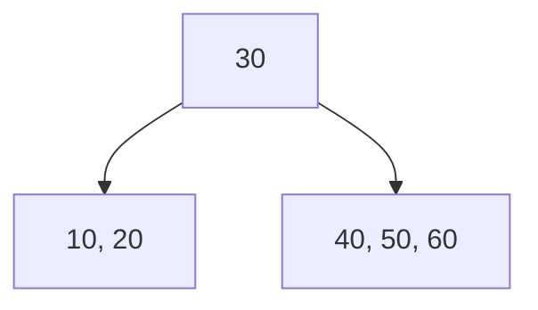
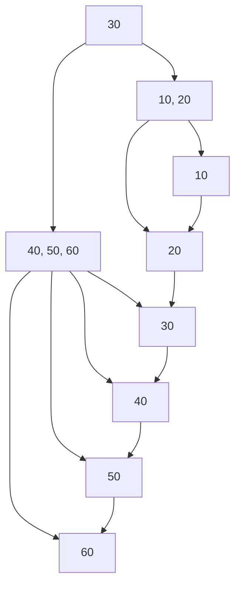

# B-Tree and B+ Tree Data Structure Diagrams

## B-Tree Data Structure Diagram

A B-Tree is a self-balancing tree data structure in which each node can contain multiple child nodes. The figure below shows a simple B-Tree:

In this example:

- The root node contains a single key value 30, and is split into two child nodes.
- The left child node contains key values 10 and 20.
- The right child node contains key values 40, 50 and 60.
- All leaf nodes are at the same level.

## B+ Tree Data Structure Diagram

A B+ Tree is a variant of the B-Tree in which all data is stored in leaf nodes, while internal nodes store only indexes. The figure below shows a simple B+ Tree:

In this example:

- The root node contains a single index key value 30, and is split into two child nodes.
- Internal nodes contain index key values 10, 20 and 40, 50, 60.
- All data is stored in leaf nodes, which contain key values 10, 20, 30, 40, 50 and 60.
- Leaf nodes form a linked list, used for sequential access and range queries.

## Data structure characteristics

### B-Tree
- **Node structure**: Each node contains multiple key values and child node pointers.
- **Balance**: All leaf nodes are at the same level, keeping the tree height balanced.
- **Data storage**: Data can be stored in internal nodes and leaf nodes.

### B+ Tree
- **Node structure**: Internal nodes store only index key values, while leaf nodes store all data.
- **Balance**: All leaf nodes are at the same level, keeping the tree height balanced.
- **Linked list structure**: Leaf nodes form a linked list, supporting sequential access and range queries.
- **Data storage**: All data is stored in leaf nodes, while internal nodes store only indexes.

## Comparison

- **Query performance**: The leaf nodes of a B+ Tree form a linked list, so sequential access and range query performance is better than that of a B-Tree.
- **Insert/delete operations**: Insert and delete operations on a B+ Tree may cause node splitting and merging, but its balance and low tree height reduce disk I/O operations.
- **Storage efficiency**: A B+ Tree's internal nodes store only indexes and leaf nodes store all data, giving higher storage efficiency.

## Summary

Both B-Tree and B+ Tree are efficient balanced tree data structures, widely used in database systems. The B+ Tree, due to its linked list structure and efficient sequential access, is typically used as a database index. Understanding their structure and characteristics helps optimise database performance and choose the right index type.

MySQL indexes make widespread use of B+ Tree and B-Tree because these tree structures have efficient performance and flexibility when handling large volumes of data. Below are the reasons why MySQL indexes use B+ Tree and B-Tree, and their comparison with other common index data structures.

## Why use B+ Tree and B-Tree?

### B-Tree
- **Definition**: A B-Tree is a self-balancing tree data structure, widely used in databases and file systems. It can maintain the ordering of data and allows efficient insert, delete and lookup operations on the data.
- **Characteristics**:
  - Each node can have multiple child nodes.
  - All leaf nodes are at the same level.
  - Has balance, ensuring a low tree height and thereby reducing disk I/O operations.

### B+ Tree
- **Definition**: A B+ Tree is a variant of the B-Tree in which all data is stored in leaf nodes and internal nodes store only indexes.
- **Characteristics**:
  - Leaf nodes form a linked list, supporting range queries and sequential access.
  - All data is stored in leaf nodes and internal nodes store only indexes, reducing the tree height.
  - Better suited to database storage and retrieval needs, especially sequential access and range queries.

## Pros and cons of B+ Tree and B-Tree

### Pros:
1. **Efficient query performance**:
   - Both B+ Tree and B-Tree maintain a balanced tree height, ensuring that lookup, insert and delete operations have O(log n) time complexity.
   - The leaf nodes of a B+ Tree form a linked list, making sequential access and range queries convenient.
2. **Low disk I/O**:
   - Nodes in B+ Tree and B-Tree can typically hold multiple key-value pairs, reducing the tree height and the number of disk I/O operations.
3. **Good cache hit rate**:
   - B+ Tree and B-Tree have a high fan-out and a low tree height, which can increase the cache hit rate and improve query performance.

### Cons:
1. **Complex implementation**:
   - Compared with simple data structures such as hash tables, the implementation of B+ Tree and B-Tree is more complex.
2. **Cost of update operations**:
   - Insert and delete operations may cause node splitting and merging, adding some overhead.

## Comparison with other common index data structures

### Hash table
- **Pros**:
  - Equality query performance is very high, with O(1) time complexity.
  - Simple to implement, suitable for quickly looking up a specific value.
- **Cons**:
  - Does not support range queries.
  - Hash conflict handling is complex and may affect performance.

### Inverted index
- **Pros**:
  - Suitable for full-text search and text data retrieval.
  - Supports complex text queries and word frequency statistics.
- **Cons**:
  - Complex to maintain, especially with large overhead for insert and delete operations.
  - Not suitable for equality and range queries on numeric data.

### R-Tree (spatial index)
- **Pros**:
  - Suitable for storing and querying multi-dimensional data, such as in Geographic Information Systems (GIS).
  - Supports efficient spatial queries, such as range queries and nearest-neighbour queries.
- **Cons**:
  - Complex to implement, with larger overhead for insert and delete operations.
  - Not suitable for regular queries on one-dimensional data.

### Bitmap index
- **Pros**:
  - Suitable for efficient queries on low-cardinality columns (columns with few unique values).
  - High query performance for boolean type data and low-cardinality data.
- **Cons**:
  - For high-cardinality columns, a bitmap index takes up a lot of space.
  - Suitable for read-only or low-update environments; update overhead is large.

## Conclusion

B+ Tree and B-Tree are very well suited to the index structure of relational databases due to their balance and low disk I/O operations. They provide efficient equality queries, range queries and sequential access, balancing performance and flexibility. Other data structures such as hash tables, inverted indexes, R-Tree and bitmap indexes have their advantages in specific scenarios, but in terms of generality and overall performance they are not as well suited to the needs of a database system as B+ Tree and B-Tree.

## References

- [MySQL 8.0 Reference Manual · InnoDB Storage Engine](https://dev.mysql.com/doc/refman/8.0/en/innodb-storage-engine.html)
- [MySQL 8.0 Reference Manual · InnoDB Architecture](https://dev.mysql.com/doc/refman/8.0/en/innodb-architecture.html)
- [MySQL 8.0 Reference Manual · InnoDB Indexes](https://dev.mysql.com/doc/refman/8.0/en/innodb-indexes.html)

<!-- BACKLINKS-AUTO -->
## Related pages

- [README](README.md)
- [glossary](/glossary.md)
- [knowledge](/knowledge.md)
