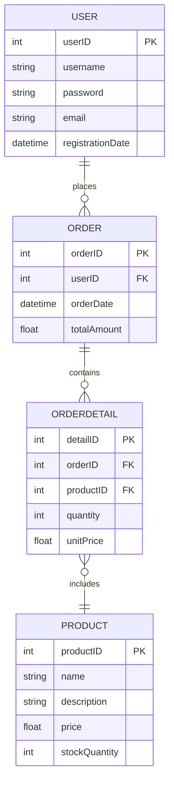

# Entity-Relationship Model (ER Diagrams)

## What Is the Entity-Relationship Model

The entity-relationship model (Entity-Relationship Model, ER Model) is a high-level data model used in database design. It describes data and its relationships through entities, attributes and relationships. An ER diagram (Entity-Relationship Diagram) is the graphical representation of the entity-relationship model, used to visually present the structure and design of a database.

## Components of an ER Diagram

1. **Entity**:
   - An entity refers to an object or concept in the real world, usually a noun, such as "user" or "product".
   - In an ER diagram, an entity is represented by a rectangle.

2. **Attribute**:
   - An attribute is a specific data item of an entity, used to describe its characteristics, such as "username" or "price".
   - In an ER diagram, an attribute is represented by an ellipse, connected to its corresponding entity.

3. **Relationship**:
   - A relationship describes the association between entities, such as "user places order" or "order contains product".
   - In an ER diagram, a relationship is represented by a diamond, connected to the participating entities.

4. **Key**:
   - Primary Key: an attribute or combination of attributes that uniquely identifies an entity instance.
   - Foreign Key: used to reference the primary key of another entity from one entity, representing the association between entities.

## How to Represent an ER Diagram

1. **Entity**:
   - A rectangle represents an entity, with the entity name written inside.
   - A weak entity is represented by a double-lined rectangle, indicating that its existence depends on another entity.

2. **Attribute**:
   - An ellipse represents an attribute, with the attribute name written inside, connected to its corresponding entity.
   - A multivalued attribute is represented by a double-lined ellipse, meaning an entity instance can have multiple values for that attribute.
   - A derived attribute is represented by a dashed ellipse, meaning its value can be derived from other attributes.

3. **Relationship**:
   - A diamond represents a relationship, with the relationship name written inside, connected to the participating entities.
   - The cardinality of a relationship represents the number relationship between participating entities, such as one-to-one, one-to-many and many-to-many.

## ER Diagram Example

The following is a simple ER diagram example for an e-commerce system:

## Things to Watch Out For in ER Design

1. **Clear Requirements**: Before drawing an ER diagram, make sure you have a clear understanding of the system's business requirements.
2. **Precise Representation**: The representation of entities, attributes and relationships should be as precise as possible, to avoid ambiguity.
3. **Keep It Simple**: An ER diagram should be as concise as possible, avoiding unnecessary complexity, to make it easy to understand and communicate.
4. **Standardised Naming**: Use a consistent naming convention to ensure consistency and readability of entity, attribute and relationship names.

## References

- [MySQL 8.0 Reference Manual · Database Objects](https://dev.mysql.com/doc/refman/8.0/en/what-is-mysql.html)
- [CREATE TABLE / ALTER TABLE / DROP TABLE](https://dev.mysql.com/doc/refman/8.0/en/create-table.html)

<!-- BACKLINKS-AUTO -->
## Related pages

- [README](README.md)
